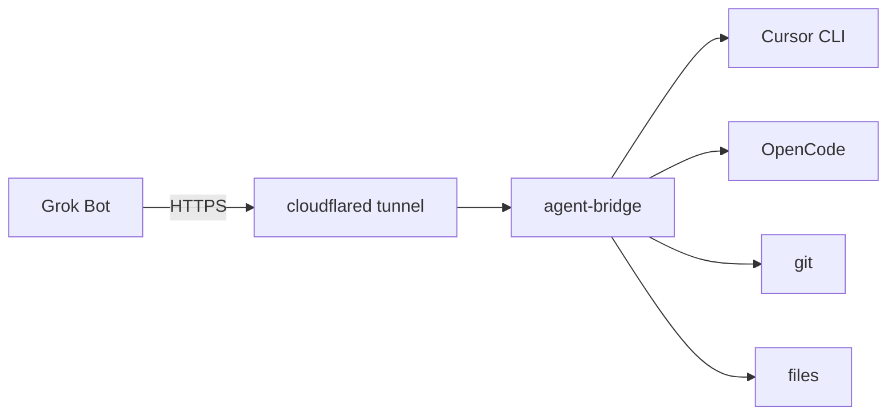

Português: [README.pt-BR.md](README.pt-BR.md)

# agent-bridge

[](https://www.npmjs.com/package/@spec-protocol/agent-bridge)
[](https://github.com/spec-protocol/agent-bridge/blob/main/LICENSE)
[](https://nodejs.org)

Local MCP bridge: Grok talks to Cursor, OpenCode, git, and files on your machine.

<!-- DEMO: drop a GIF or screenshot here when you have one (do not invent a binary). -->



Grok Bot reaches your machine through an HTTPS tunnel and talks to the Cursor CLI, optional OpenCode, git, and local files. Task traffic does not go through a third-party API.

Copyright 2026 ARJOS Tech. License [Apache 2.0](LICENSE). Source: [github.com/spec-protocol/agent-bridge](https://github.com/spec-protocol/agent-bridge).

> [!IMPORTANT]
> Put the Bearer token only in Grok’s protected field — never in chat. On the machine, run `agent-bridge token copy` and paste into that field.

> [!TIP]
> OpenCode is optional. The bridge works with Cursor alone; `ask_opencode` stays unavailable until OpenCode is installed.

## Requirements

- Node.js `>=18` (see `package.json` `engines`)
- [Cursor CLI](https://cursor.com/docs/cli/overview) (`agent`) installed and logged in (`agent login`)
- `cloudflared` for the public HTTPS tunnel
- OpenCode — optional, only if you want `ask_opencode`

## 1. Install

```bash
npm install -g @spec-protocol/agent-bridge
```

## 2. Connect this machine

Do two different things: one in the **terminal**, one in **Cursor chat**.

### Terminal — `agent-bridge init`

In the project directory:

```bash
agent-bridge init
```

This adds the directory to the Grok allowlist, updates the installation `.env`, starts the service on first run, and installs the Cursor skill. Cursor CLI (`agent`) is required; OpenCode missing is only a warning.

### Cursor chat — `/agent-bridge`

In Cursor chat, run:

```text
/agent-bridge
```

Expect **two lines** (MCP URL + guide link). Copy **that block** into Grok — not the Bearer token.

Example shape:

```text
Connect the Streamable HTTP MCP at this URL: https://….trycloudflare.com/mcp
Follow this guide and finish the connection: https://unpkg.com/@spec-protocol/agent-bridge@…/docs/public/grok.md
```

## 3. Create the Grok Bot

1. Create a Grok Bot and paste only that two-line output.
2. On the machine, run `agent-bridge token copy` and paste the token into Grok’s **protected field** (never into chat).
3. Grok opens the guide and finishes the connection.

## Tools

| Tool | What it does | Access |
| --- | --- | --- |
| `list_repos` | Allowlist of repos and OpenCode availability | read |
| `ask_cursor` | Cursor CLI in the repo (default `ask`) | read by default; write only with `mode=agent` **and** `ALLOW_WRITE=1` |
| `start_ask_cursor` | Same as `ask_cursor`, as an async job | same as `ask_cursor` |
| `ask_opencode` | OpenCode `plan` agent (optional) | read |
| `start_ask_opencode` | Same as `ask_opencode`, as an async job | read |
| `get_job` | Poll status/result of a job | read |
| `cancel_job` | Cancel queued job or stop a running one | write / side-effect (`SIGTERM`) |
| `list_opencode_sessions` | List OpenCode sessions in the repo | read |
| `git_readonly` | Read-only git subcommands | read |
| `read_file` | Read a file in the repo | read (secrets blocked) |
| `list_files` | List files in the repo | read |
| `list_bridge_audit` | Local audit metadata | read |

### Example Grok chat

You: *What repos can you see?*

Grok calls `list_repos`, then maybe `git_readonly` with `["status"]`, then `ask_cursor` with a short question about the default repo.

## Security

- **Repo allowlist** — only directories listed in `REPOS` are reachable.
- **Read-only git** — `git_readonly` allows a fixed set of subcommands (`log`, `diff`, `status`, …); write/exec options are rejected.
- **`ALLOW_WRITE` off by default** — `mode=agent` on Cursor tools needs `ALLOW_WRITE=1`.
- **Sensitive files blocked** — `read_file` / `list_files` refuse `.env`, credentials, keys, `.git`, `secrets/`, and extra `READ_DENY_GLOBS`.
- **Audit log** — default path `~/.local/share/agent-bridge/` (override with `BRIDGE_AUDIT_DIR`). Metadata only unless `BRIDGE_AUDIT_BODY=1` (do not enable if logs leave the machine).
- **Bearer only in the protected field** — never paste the token in chat.
- **Listens on `127.0.0.1`** — public reachability is via the tunnel, not a wide-open bind.
- **`agent-bridge token copy`** — copies to the clipboard and never prints the token. Clear the clipboard after pasting into the protected field.

## Troubleshooting

| Problem | What to do |
| --- | --- |
| Tunnel URL changed | Ask Grok to reconnect with the new two-line block. The token stays the same. |
| Default repo `my-repo` | That name is the `.env.example` placeholder path. Set a real path in `.env`, or always pass `repo` to tools. |
| OpenCode “binary is not executable” | `chmod +x` the binary, or reinstall OpenCode / fix `OPENCODE_BIN`. |
| Clipboard tool missing for `token copy` | Install `wl-copy`, `xclip`, or `xsel` (Linux), or open the `.env` path shown in the error and copy `BRIDGE_TOKEN` by hand. |

More detail: [docs/public/README.md](docs/public/README.md). Guide Grok runs: [docs/public/grok.md](docs/public/grok.md).
