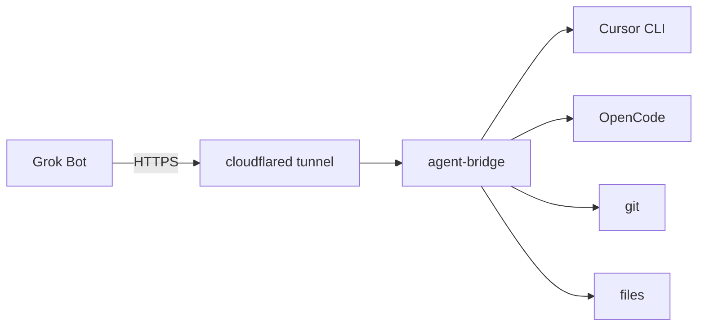

English: [README.md](README.md)

# agent-bridge

[](https://www.npmjs.com/package/@spec-protocol/agent-bridge)
[](https://github.com/spec-protocol/agent-bridge/blob/main/LICENSE)
[](https://nodejs.org)

Ponte MCP local: o Grok fala com Cursor, OpenCode, git e arquivos na sua máquina.

<!-- DEMO: coloque um GIF ou screenshot aqui quando tiver (não invente um binário). -->



O Grok Bot chega na sua máquina por um túnel HTTPS e fala com o Cursor CLI, o OpenCode (opcional), git e arquivos locais. O tráfego da tarefa não passa por uma API de terceiros.

Copyright 2026 ARJOS Tech. Licença [Apache 2.0](LICENSE). Fonte: [github.com/spec-protocol/agent-bridge](https://github.com/spec-protocol/agent-bridge).

> [!IMPORTANT]
> Coloque o token Bearer só no campo protegido do Grok — nunca no chat. Na máquina, rode `agent-bridge token copy` e cole nesse campo.

> [!TIP]
> O OpenCode é opcional. A ponte funciona só com o Cursor; `ask_opencode` fica indisponível até o OpenCode estar instalado.

## Requirements

- Node.js `>=18` (veja `engines` em `package.json`)
- [Cursor CLI](https://cursor.com/docs/cli/overview) (`agent`) instalado e logado (`agent login`)
- `cloudflared` para o túnel HTTPS público
- OpenCode — opcional, só se quiser `ask_opencode`

## 1. Install

```bash
npm install -g @spec-protocol/agent-bridge
```

## 2. Conectar esta máquina

São duas coisas diferentes: uma no **terminal**, outra no **chat do Cursor**.

### Terminal — `agent-bridge init`

No diretório do projeto:

```bash
agent-bridge init
```

Isso inclui o diretório na allowlist do Grok, atualiza o `.env` da instalação, sobe o serviço na primeira vez e instala a skill do Cursor. O Cursor CLI (`agent`) é obrigatório; OpenCode ausente só gera aviso.

### Chat do Cursor — `/agent-bridge`

No chat do Cursor, rode:

```text
/agent-bridge
```

Espere **duas linhas** (URL do MCP + link do guia). Copie **esse bloco** para o Grok — não o token Bearer.

Formato esperado:

```text
Connect the Streamable HTTP MCP at this URL: https://….trycloudflare.com/mcp
Follow this guide and finish the connection: https://unpkg.com/@spec-protocol/agent-bridge@…/docs/public/grok.md
```

## 3. Criar o Grok Bot

1. Crie o Grok Bot e cole **só** esse output de duas linhas.
2. Na máquina, rode `agent-bridge token copy` e cole o token no **campo protegido** do Grok (nunca no chat).
3. O Grok abre o guia e conclui a conexão.

## Tools

| Tool | O que faz | Acesso |
| --- | --- | --- |
| `list_repos` | Allowlist de repositórios e se o OpenCode está disponível | read |
| `ask_cursor` | Cursor CLI no repo (padrão `ask`) | read por padrão; write só com `mode=agent` **e** `ALLOW_WRITE=1` |
| `start_ask_cursor` | Igual a `ask_cursor`, como job assíncrono | igual a `ask_cursor` |
| `ask_opencode` | Agente `plan` do OpenCode (opcional) | read |
| `start_ask_opencode` | Igual a `ask_opencode`, como job assíncrono | read |
| `get_job` | Consulta status/resultado de um job | read |
| `cancel_job` | Cancela job na fila ou interrompe um em execução | write / efeito colateral (`SIGTERM`) |
| `list_opencode_sessions` | Lista sessões OpenCode no repo | read |
| `git_readonly` | Subcomandos de leitura do git | read |
| `read_file` | Lê um arquivo no repo | read (segredos bloqueados) |
| `list_files` | Lista arquivos no repo | read |
| `list_bridge_audit` | Metadados da auditoria local | read |

### Exemplo de chat com o Grok

Você: *Quais repositórios você vê?*

O Grok chama `list_repos`, depois talvez `git_readonly` com `["status"]`, e então `ask_cursor` com uma pergunta curta sobre o repo padrão.

## Security

- **Allowlist de repos** — só diretórios listados em `REPOS` são alcançáveis.
- **Git somente leitura** — `git_readonly` permite um conjunto fixo de subcomandos (`log`, `diff`, `status`, …); opções de escrita/execução são rejeitadas.
- **`ALLOW_WRITE` desligado por padrão** — `mode=agent` nas tools do Cursor exige `ALLOW_WRITE=1`.
- **Arquivos sensíveis bloqueados** — `read_file` / `list_files` recusam `.env`, credentials, chaves, `.git`, `secrets/` e `READ_DENY_GLOBS` extras.
- **Log de auditoria** — caminho padrão `~/.local/share/agent-bridge/` (override com `BRIDGE_AUDIT_DIR`). Só metadados, a menos que `BRIDGE_AUDIT_BODY=1` (não ative se os logs saírem da máquina).
- **Bearer só no campo protegido** — nunca cole o token no chat.
- **Escuta em `127.0.0.1`** — o acesso público é pelo túnel, não por bind aberto.
- **`agent-bridge token copy`** — copia para a área de transferência e nunca imprime o token. Limpe a área de transferência depois de colar no campo protegido.

## Troubleshooting

| Problema | O que fazer |
| --- | --- |
| URL do túnel mudou | Peça ao Grok para reconectar com o novo bloco de duas linhas. O token continua o mesmo. |
| Repo padrão `my-repo` | Esse nome é o caminho placeholder do `.env.example`. Defina um caminho real no `.env`, ou sempre passe `repo` nas tools. |
| OpenCode “binary is not executable” | `chmod +x` no binário, ou reinstale o OpenCode / corrija `OPENCODE_BIN`. |
| Ferramenta de clipboard ausente no `token copy` | Instale `wl-copy`, `xclip` ou `xsel` (Linux), ou abra o caminho do `.env` mostrado no erro e copie `BRIDGE_TOKEN` à mão. |

Mais detalhes: [docs/public/README.md](docs/public/README.md). Guia que o Grok executa: [docs/public/grok.md](docs/public/grok.md).
